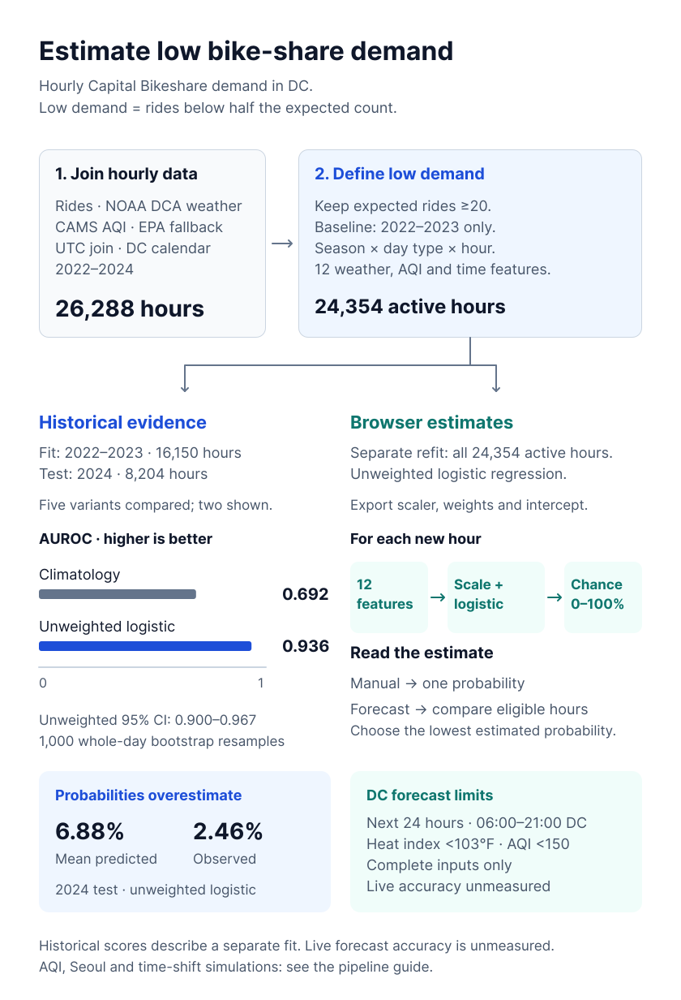
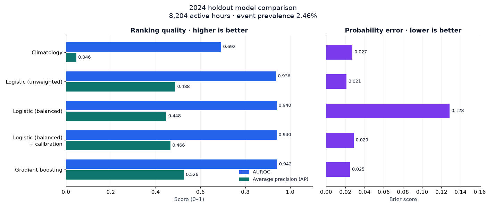
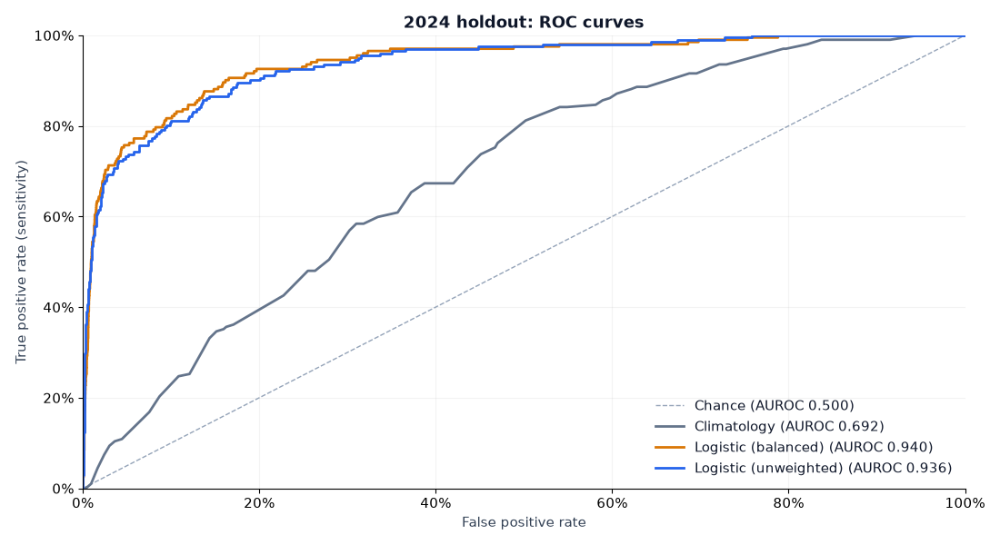
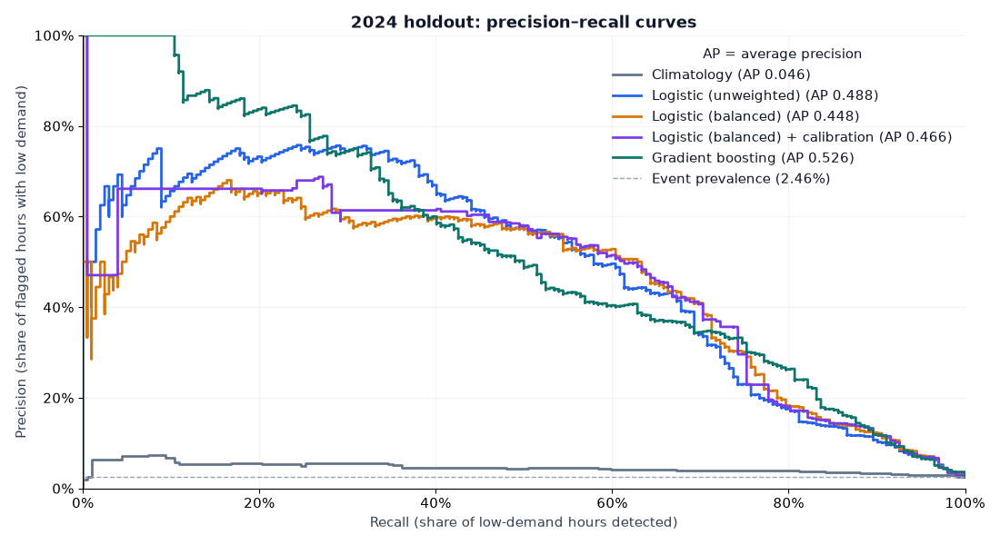
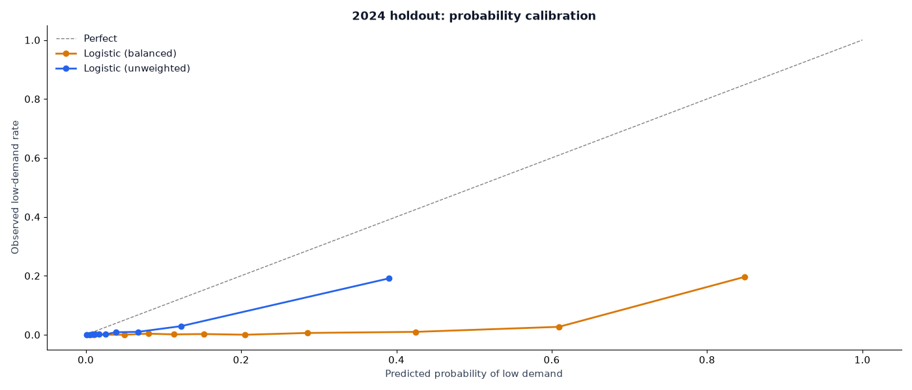
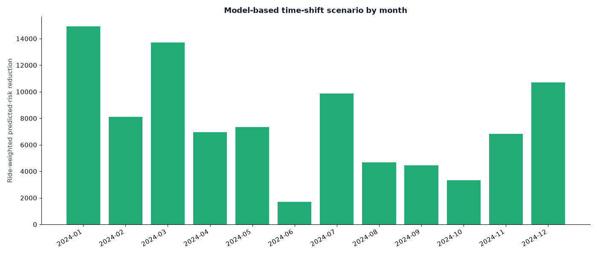
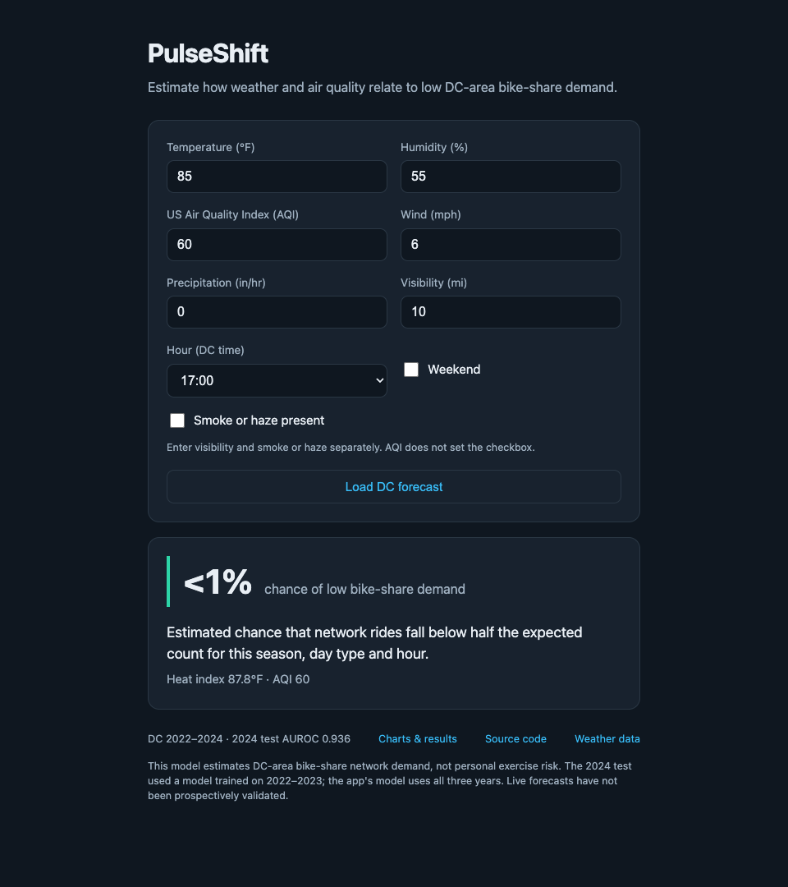
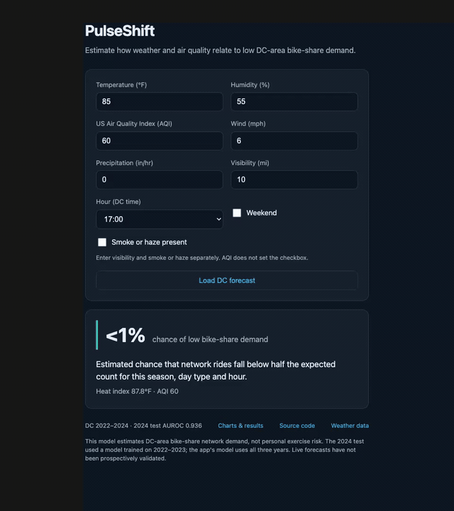
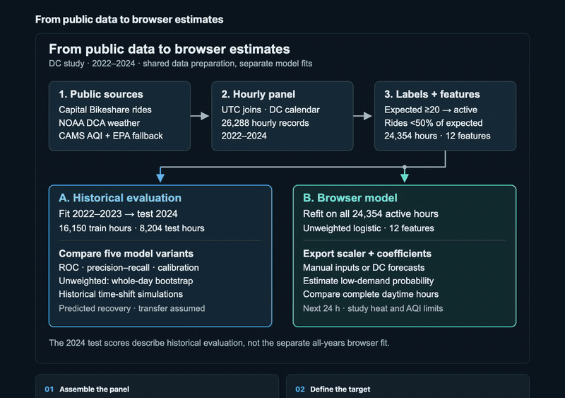

# PulseShift

PulseShift estimates the chance that hourly Capital Bikeshare rides fall below half their expected count. A 12-feature logistic regression model runs in the browser, using manual conditions or DC forecasts. This is a research prototype for aggregate network demand.

<a href="results/figures/pipeline.svg">
  <picture>
    <source media="(max-width: 640px)" srcset="results/figures/pipeline-mobile.svg">
    
  </picture>
</a>

[Pipeline details](docs/pipeline.md) · [Figma source](https://www.figma.com/design/yhY22TCHa8m8mhBi1Z4RCw?node-id=2-2)

[Open the app](https://urmeo.github.io/pulse-shift/) · [Visual report](https://urmeo.github.io/pulse-shift/results/) · [Data and methods](results/README.md)

| AUROC | Average precision | Brier score | Active DC hours |
| ---: | ---: | ---: | ---: |
| **0.936** | **0.488** | **0.021** | **24,354** |

Scores describe the unweighted model trained on **16,150 hours in 2022–2023** and tested on **8,204 hours in 2024**. The browser uses a separate refit on all 24,354 active hours. Both fits use the same 2022–2023 target baseline.

## Model evaluation

These charts use the historical 2024 test set. Open any chart to view it at full size.

[](results/figures/model_comparison.png)

Higher AUROC and average precision are better; a lower Brier score is better.

[](results/figures/roc.png)

ROC curves compare true-positive and false-positive rates across thresholds.

[](results/figures/precision_recall.png)

Precision–recall curves show how many flagged hours have low demand as recall increases.

[](results/figures/reliability.png)

The unweighted model predicted **6.88%** low demand on average; the observed rate was **2.46%**. Its probabilities overestimate the 2024 event rate.

| Model | AUROC ↑ | Average precision ↑ | Brier score ↓ | Calibration error (ECE) ↓ |
| --- | ---: | ---: | ---: | ---: |
| Climatology | 0.692 | 0.046 | 0.027 | 0.053 |
| **Unweighted logistic** | **0.936** | **0.488** | **0.021** | **0.044** |
| Balanced logistic | 0.940 | 0.448 | 0.128 | 0.253 |
| Balanced logistic + isotonic calibration | 0.940 | 0.466 | 0.029 | 0.064 |
| Gradient boosting | 0.942 | 0.526 | 0.025 | 0.046 |

For the unweighted model, **95% intervals from resampling whole days** are **0.900–0.967** for AUROC, **0.319–0.638** for average precision and **0.017–0.026** for Brier score. Download the [model scores](results/tables/model_comparison.csv), [confidence intervals](results/tables/served_ci.csv) or [test predictions](results/tables/holdout_predictions.csv).

## Time-shift scenario

A simulated shift of up to **three hours** produced a predicted recovery of **36.8% of modeled lost rides** (95% interval **33.0–40.9%**). This assumes full transfer to the chosen hours. At an assumed **50% transfer efficiency**, recovery is **18.4%**.

[](results/figures/ram_by_month.png)

These are simulations, not observed ride recovery. The analysis compares same-day hours within ±3 hours using historical 2024 predictions, with heat index below 103°F and AQI below 150.

| Simulated shifts | Cancellations | Study-threshold violations |
| ---: | ---: | ---: |
| 1,126 | 9 | 0 |

[Policy predictions](results/tables/policy_predictions.csv) · [Sensitivity results](results/tables/sensitivity_policy.csv)

## More charts and data

| Chart | Supporting data |
| --- | --- |
| [Decision curve](results/figures/decision_curve.png) | [Decision scores](results/tables/decision_curve.csv) |
| [Heat and AQI exposure curves](results/figures/exposure_response.png) | [Exposure response](results/tables/exposure_response.csv) |
| [Daily and hourly AQI associations](results/figures/aqi_identification.png) | [AQI estimates](results/tables/aqi_identification.csv) |
| [June 2023 smoke event](results/figures/smoke_event.png) | [Event summary](results/tables/smoke_event.csv) |

<details>
<summary>Supporting analyses and tools</summary>

### AQI and smoke

Adding AQI after weather changed AUROC from **0.936475 to 0.936477**. Average precision and Brier score became slightly worse. The [feature comparison](results/tables/ablation.csv) records the results.

AQI associations use applicable records across 2022–2024. Daily and hourly associations use different exposures and controls. Their difference does not establish causality or isolate measurement error. The heat and AQI exposure curves are unadjusted associations.

### Separate Seoul refit

| Training hours | Test hours | AUROC | Average precision | Brier score |
| ---: | ---: | ---: | ---: | ---: |
| 6,305 | 2,160 | 0.873 | 0.694 | 0.064 |

The Seoul analysis fits city-specific coefficients and holds out the **latest 25% of dates within each season**, keeping whole dates together. It does not test transfer of the DC coefficients or use a global chronological forecast split. See the [Seoul results](results/tables/seoul_validation.csv) and [dataset and split metadata](results/tables/seoul_provenance.json).

### Data and tools

| Item | Source or coverage |
| --- | --- |
| DC panel | 26,288 network-hours, 2022–2024; 16 calendar hours absent |
| Rides | Capital Bikeshare aggregate hourly counts |
| Weather | NOAA observations from Reagan National Airport (DCA) |
| Air quality | CAMS hourly AQI for 80.3% of hours; EPA daily AQI fallback |
| Research | Python, NumPy, pandas, scikit-learn, SciPy and Matplotlib |
| Browser | HTML, CSS and JavaScript; no runtime packages |

</details>

<details>
<summary>App and video walkthroughs</summary>

<a href="https://urmeo.github.io/pulse-shift/">
  <picture>
    <source media="(max-width: 640px)" srcset="docs/media/app-mobile.png">
    
  </picture>
</a>

These silent recordings show the working interface. Select a preview to play the full video with controls and English captions.

| Manual app estimates | Pipeline and research charts |
| --- | --- |
| <a href="https://urmeo.github.io/pulse-shift/docs/demos/#app"><picture><source media="(prefers-reduced-motion: reduce)" srcset="docs/media/app-desktop.png"></picture></a> | <a href="https://urmeo.github.io/pulse-shift/docs/demos/#results"><picture><source media="(prefers-reduced-motion: reduce)" srcset="docs/media/results-overview.png"></picture></a> |
| [Watch the app video](https://urmeo.github.io/pulse-shift/docs/demos/#app) · [MP4](docs/media/app-walkthrough.mp4) | [Watch the results video](https://urmeo.github.io/pulse-shift/docs/demos/#results) · [MP4](docs/media/results-walkthrough.mp4) |

The app recording uses manual conditions. The results recording shows historical evaluation and simulations; live forecast accuracy and actual ride recovery remain unmeasured.

</details>

## Run locally

```bash
git clone https://github.com/urmeo/pulse-shift.git
cd pulse-shift
python3 -m http.server 8000
```

Author and sole contributor: [urme](https://github.com/urmeo) · [MIT license](LICENSE)
