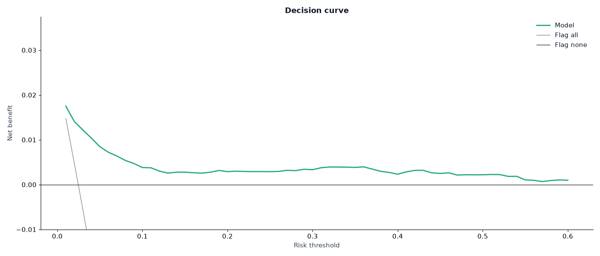
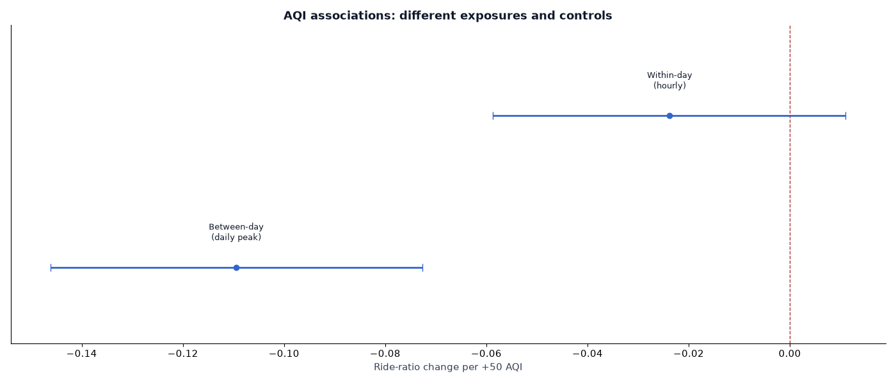
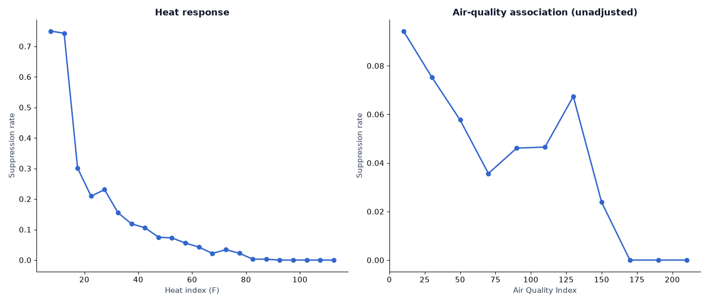
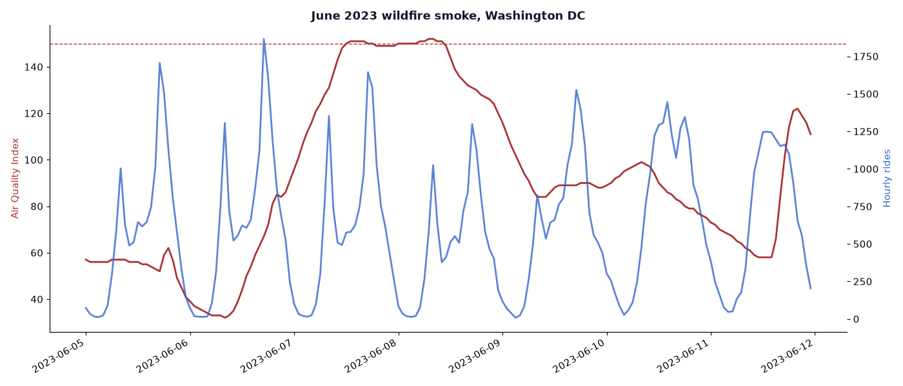

# PulseShift

PulseShift estimates the chance that hourly Capital Bikeshare rides fall below half their expected count. A 12-feature logistic regression model runs in the browser. Enter conditions manually or load a DC forecast to compare daytime hours. This is a research prototype for aggregate network demand.

[Open the app](https://urmeo.github.io/pulse-shift/) · [Charts and results](https://urmeo.github.io/pulse-shift/results/) · [Data and methods](results/README.md) · [Reproduce the analysis](docs/development.md)

<a href="https://urmeo.github.io/pulse-shift/">
  <picture>
    <source media="(max-width: 640px)" srcset="docs/media/app-mobile.png">
    
  </picture>
</a>

## Run locally

From the repository root:

```bash
python3 -m http.server 8000
```

Open [localhost:8000](http://localhost:8000) for the app or [localhost:8000/results/](http://localhost:8000/results/) for the visual report. Manual estimates run locally. Forecast loading requires internet access.

To reproduce the research, follow the [development guide](docs/development.md). It covers Python setup, checks, analysis scripts and panel rebuilding.

## Video walkthroughs

These silent recordings show the working interface. Select a preview to play the full video with controls and English captions.

| Manual app estimates | Pipeline and research charts |
| --- | --- |
| <a href="https://urmeo.github.io/pulse-shift/docs/demos/#app"><picture><source media="(prefers-reduced-motion: reduce)" srcset="docs/media/app-desktop.png"></picture></a> | <a href="https://urmeo.github.io/pulse-shift/docs/demos/#results"><picture><source media="(prefers-reduced-motion: reduce)" srcset="docs/media/results-overview.png"></picture></a> |
| [Watch the app video](https://urmeo.github.io/pulse-shift/docs/demos/#app) · [MP4](docs/media/app-walkthrough.mp4) | [Watch the results video](https://urmeo.github.io/pulse-shift/docs/demos/#results) · [MP4](docs/media/results-walkthrough.mp4) |

The app recording uses manual conditions. The results recording shows historical evaluation and simulations; live forecast accuracy and actual ride recovery remain unmeasured.

## Pipeline

<a href="results/figures/pipeline.svg">
  <picture>
    <source media="(max-width: 640px)" srcset="results/figures/pipeline-mobile.svg">
    
  </picture>
</a>

| Stage | What happens | Recorded output |
| --- | --- | --- |
| Prepare | Join rides and weather by UTC hour; add DC calendar fields and CAMS AQI, with EPA daily fallback. | 26,288 hourly records and a [panel checksum](research/data/processed/panel.sha256) |
| Define the target | Fit expected rides by season, weekday/weekend group and hour on 2022–2023. Keep expected counts ≥20; label actual counts below 50% of expected. Derive 12 weather, AQI and time features. | 24,354 active hours |
| Evaluate | Fit five model variants on 16,150 hours from 2022–2023; test on 8,204 hours from 2024. | [Test predictions](results/tables/holdout_predictions.csv), curves and model scores |
| Check uncertainty and scenarios | Resample whole test days for the unweighted model's intervals; vary features, labels and policy settings; simulate same-day shifts of up to three hours. | [Confidence intervals](results/tables/served_ci.csv), sensitivity tables and simulated recovery |
| Refit and use | Fit a separate unweighted logistic model on all active hours. Export its scaler and coefficients; score manual inputs or a DC forecast. | [Browser model](app/model.js) and next-24-hour daytime comparisons |

Expected-ride labels use the **2022–2023 baseline in both paths**. The all-years browser refit does not redefine that baseline. The 2024 test scores describe the historical model fit.

AQI associations use applicable records across 2022–2024. Seoul starts from its own dataset and fits city-specific coefficients. The [full pipeline guide](docs/pipeline.md) traces these separate analyses, preprocessing limits and code paths.

## Historical results

**2022–2023 training → 2024 test.** All five models use the same 16,150 training hours, 8,204 test hours and training-fitted target described above.

| Model | AUROC ↑ | Average precision ↑ | Brier score ↓ | Calibration error (ECE) ↓ |
| --- | ---: | ---: | ---: | ---: |
| Climatology | 0.692 | 0.046 | 0.027 | 0.053 |
| **Unweighted logistic** | **0.936** | **0.488** | **0.021** | **0.044** |
| Balanced logistic | 0.940 | 0.448 | 0.128 | 0.253 |
| Balanced logistic + isotonic calibration | 0.940 | 0.466 | 0.029 | 0.064 |
| Gradient boosting | 0.942 | 0.526 | 0.025 | 0.046 |

For the unweighted model, **95% intervals from resampling whole days** are **0.900–0.967** for AUROC, **0.319–0.638** for average precision and **0.017–0.026** for Brier score. Download the [model scores](results/tables/model_comparison.csv), [confidence intervals](results/tables/served_ci.csv) or [test predictions](results/tables/holdout_predictions.csv).

[](results/figures/model_comparison.png)

| ROC curves | Precision–recall curves |
| --- | --- |
| [](results/figures/roc.png) | [](results/figures/precision_recall.png) |

The unweighted model's mean prediction was **6.88%**, while the observed low-demand rate was **2.46%**. Its probabilities overestimate the 2024 event rate.

| Calibration | Decision curve |
| --- | --- |
| [](results/figures/reliability.png) | [](results/figures/decision_curve.png) |

Open any chart to view it at full size.

## Simulated time shifts

Allowing shifts of up to **three hours** produced **1,126 shifts**, **9 cancellations** and **0 study-threshold violations**. Predicted recovery was **36.8% of modeled lost rides** (95% interval **33.0–40.9%**) under full transfer to the chosen hours. Assuming **50% transfer efficiency** gives **18.4%** recovery.

These are simulations. Actual ride recovery and the benefits of changing ride times were not measured. See the [policy predictions](results/tables/policy_predictions.csv) and [sensitivity results](results/tables/sensitivity_policy.csv).

[](results/figures/ram_by_month.png)

## AQI and smoke

Adding AQI after weather changed AUROC from **0.936475 to 0.936477**. Average precision and Brier score became slightly worse. The [feature comparison](results/tables/ablation.csv) records the results.

Daily and hourly AQI associations use different exposures and controls. Their difference does not establish causality or isolate measurement error. The heat and AQI exposure curves below are unadjusted associations.

| Daily and hourly AQI associations | Heat and AQI exposure curves |
| --- | --- |
| [](results/figures/aqi_identification.png) | [](results/figures/exposure_response.png) |

[](results/figures/smoke_event.png)

## Separate Seoul refit

| Training hours | Test hours | AUROC | Average precision | Brier score |
| ---: | ---: | ---: | ---: | ---: |
| 6,305 | 2,160 | 0.873 | 0.694 | 0.064 |

The Seoul analysis fits city-specific coefficients and holds out the **latest 25% of dates within each season**, keeping whole dates together. It does not test transfer of the DC coefficients or use a global chronological forecast split. See the [Seoul results](results/tables/seoul_validation.csv) and [dataset and split metadata](results/tables/seoul_provenance.json).

## Data and tools

| Item | Source or coverage |
| --- | --- |
| DC panel | 26,288 network-hours, 2022–2024; 16 calendar hours absent |
| Rides | Capital Bikeshare aggregate hourly counts |
| Weather | NOAA observations from Reagan National Airport (DCA) |
| Air quality | CAMS hourly AQI for 80.3% of hours; EPA daily AQI fallback |
| Research | Python, NumPy, pandas, scikit-learn, SciPy and Matplotlib |
| Browser | HTML, CSS and JavaScript; no runtime packages |

The repository includes the processed DC panel, its checksum, predictions and generated figures. [Summary metadata](results/tables/summary.json) record source hashes and runtime versions. The [methods guide](results/README.md) explains label construction, data coverage and evaluation conditions.

## Limitations and operating conditions

- The target is aggregate bike-share demand. Individual activity and health outcomes were not measured. Live forecast accuracy and actual time-shift benefits remain unmeasured.
- Coarse CAMS data, daily AQI fallback, missing hours, changes over time and observational confounding limit interpretation.
- Forecast comparisons use **06:00–21:00 DC time** within the next 24 hours. Hours with missing inputs, heat index **≥103°F** or AQI **≥150** are excluded. These are study thresholds; follow official advisories.

Method references: [calibration](https://doi.org/10.1186/s12916-019-1466-7), [precision–recall evaluation](https://doi.org/10.1371/journal.pone.0118432), [decision curves](https://doi.org/10.1177/0272989X06295361), and the [Seoul Bike Sharing Demand dataset](https://doi.org/10.24432/C5F62R).

Author and sole contributor: [urme](https://github.com/urmeo). The [MIT license](LICENSE) covers the code; data providers' terms apply separately.
