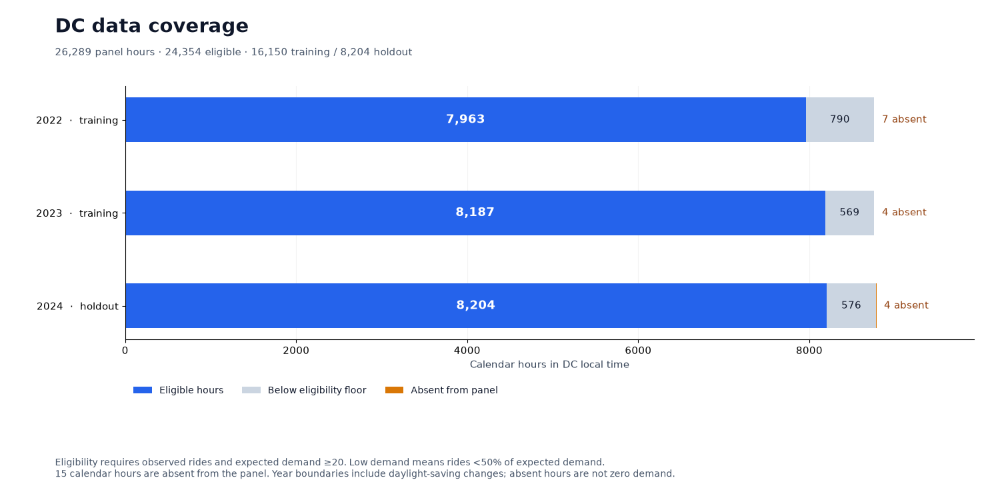
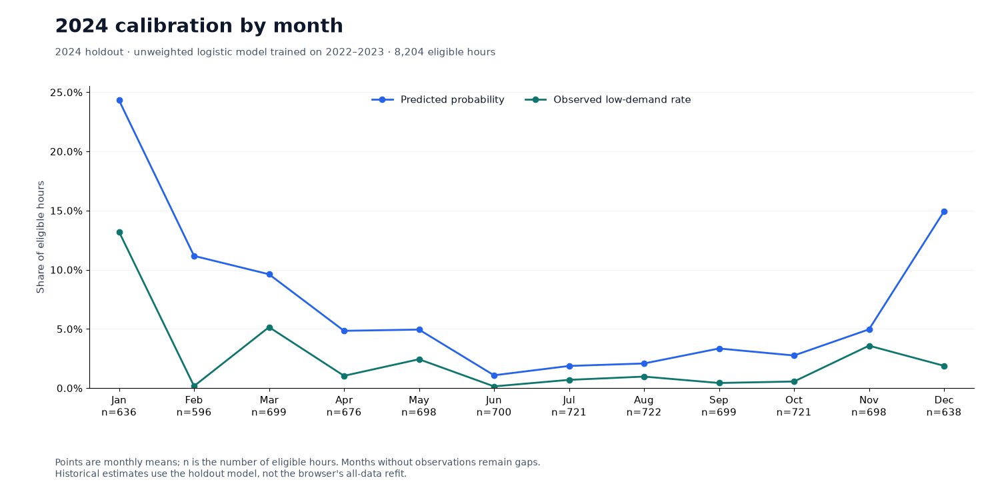
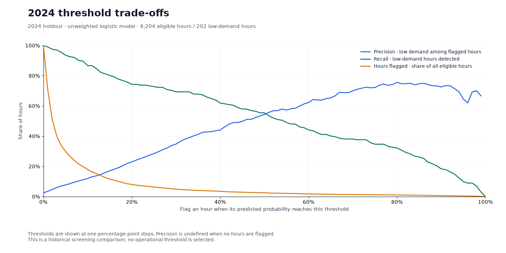
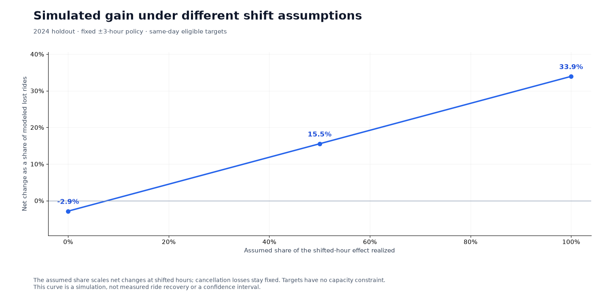
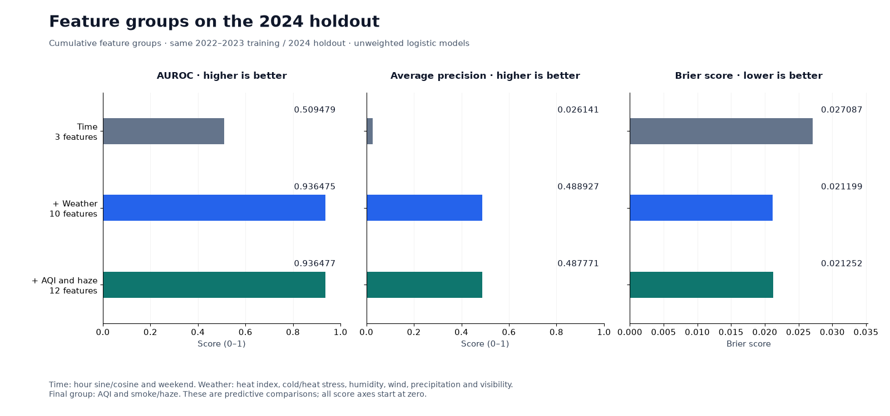

# PulseShift

PulseShift is a research prototype for hourly Capital Bikeshare demand in Washington, DC. It estimates the chance that rides fall below half their historical expected count, using a 12-feature logistic regression model. The browser accepts manual conditions or DC weather and air-quality forecasts.

## Pipeline

<a href="results/figures/pipeline.svg">
  <picture>
    <source media="(max-width: 640px)" srcset="results/figures/pipeline-mobile.svg">
    
  </picture>
</a>

[Full-size diagram](results/figures/pipeline.svg) · [Edit in Figma](https://www.figma.com/design/yhY22TCHa8m8mhBi1Z4RCw?node-id=2-2)

## How it works

### Define low demand

Hourly rides are joined with weather and AQI observations. Expected demand comes from 2022–2023 median ride counts grouped by season, weekday/weekend and hour, with a training-year volume adjustment. An hour with a recorded ride count is eligible when its expected count is at least **20 rides**. Its low-demand label is **observed rides < 50% of expected rides**. Confirmed zero counts are retained; absent observations remain missing.

| Input | Source and coverage |
| --- | --- |
| Rides | Capital Bikeshare aggregate hourly counts |
| Weather | NOAA observations from Reagan National Airport (DCA) |
| Air quality | CAMS hourly AQI for 80.3% of panel hours; EPA daily AQI fallback |
| Joined panel | 26,289 network-hours across 2022–2024; 15 calendar hours absent |

[](results/figures/data_coverage.png)

### Historical test and browser model

The historical test fits models on **16,150 eligible hours in 2022–2023** and evaluates them on **8,204 hours in 2024**. It compares climatology, logistic variants, isotonic calibration and gradient boosting.

The browser uses a separate unweighted logistic refit on **all 24,354 eligible hours**. Its scaler and coefficients are exported to JavaScript. Both model paths use the same 2022–2023 label baseline. The reported holdout scores belong to the earlier fit.

### Score conditions and compare hours

The 12 features describe heat, cold, AQI, humidity, wind, precipitation, visibility, smoke/haze, hour and weekend status. Manual inputs are scored locally. Forecast mode requests DC weather and air quality from public Open-Meteo endpoints; no account or private API key is required.

The app compares complete forecast hours between **06:00 and 21:00 DC time** within the next 24 hours. It excludes hours with heat index **≥103°F** or AQI **≥150**. These are study thresholds, not personal safety guarantees.

## Results

The unweighted model's 2024 holdout scores are:

| AUROC | Average precision | Brier score | Test hours |
| ---: | ---: | ---: | ---: |
| **0.936** | **0.488** | **0.021** | **8,204** |

### Prediction quality

[](results/figures/model_comparison.png)

[](results/figures/precision_recall.png)

### Calibration

The unweighted model predicted **6.88%** low demand on average; the observed rate was **2.46%**. Its probabilities overestimate the 2024 event rate.

[](results/figures/reliability.png)

[](results/figures/monthly_calibration.png)

### Threshold trade-offs

[](results/figures/threshold_tradeoffs.png)

### Time-shift scenario

The historical scenario allows same-day shifts within **±3 hours**, with no target capacity limit. At full modeled shift effect, net gain is **33.9% of modeled lost rides**. The **95% day-bootstrap interval is 28.5–39.1%**, conditional on the fixed baseline, model and policy. Cancellation losses are included. Actual ride recovery was not measured.

[](results/figures/transfer_sensitivity.png)

<details>
<summary>Supporting analyses: AQI and a separate Seoul refit</summary>

### AQI and smoke

[](results/figures/feature_ablation.png)

[](results/figures/aqi_identification.png)

AQI associations use applicable records across 2022–2024. Daily and hourly estimates use different exposures and controls. Their difference does not establish causality or isolate measurement error.

### Seoul refit

| Training hours | Test hours | AUROC | Average precision | Brier score |
| ---: | ---: | ---: | ---: | ---: |
| 6,305 | 2,160 | 0.873 | 0.694 | 0.064 |

Seoul uses its own coefficients and holds out the **latest 25% of dates within each season**, keeping whole dates together. This does not test transfer of DC coefficients or a single chronological forecast holdout.

</details>

## Scope and limits

- The target is aggregate network demand. Individual activity and health outcomes were not measured.
- Historical evaluation uses observed conditions. Accuracy from forecasts issued in advance remains unmeasured.
- Metric and time-shift intervals condition on saved labels, baseline, fitted predictions and policy. They assume independent days and exclude model-fitting uncertainty.
- CAMS inputs are approximately 45 km and three-hourly, returned as hourly API values. Daily AQI fallback, missing hours and observational confounding limit interpretation.

## Run locally

```bash
git clone https://github.com/urmeo/pulse-shift.git
cd pulse-shift
python3 -m http.server 8000 --bind 127.0.0.1
```

Open [localhost:8000/app/](http://localhost:8000/app/).

### Reproduce the research

Use Python 3.12 or newer. The analysis reads the checksum-verified panel, generates the nine charts and writes tables to `research/data/interim/analysis/`.

```bash
python3.12 -m venv .venv
source .venv/bin/activate
python -m pip install -r requirements.txt
export PYTHONPATH="$PWD/research${PYTHONPATH:+:$PYTHONPATH}"
python research/scripts/run_analysis.py
```

### Run the checks

The full check also requires Node.js 18 or newer and Google Chrome.

```bash
python -m pip install pytest==9.1.1 ruff==0.15.18 mypy==2.1.0 playwright==1.63.0
python research/scripts/verify.py
```

<details>
<summary>App and video walkthroughs</summary>

<a href="https://urmeo.github.io/pulse-shift/app/">
  <picture>
    <source media="(max-width: 640px)" srcset="docs/media/app-mobile.png">
    
  </picture>
</a>

| Manual app estimates | Recorded historical evaluation |
| --- | --- |
| <a href="https://urmeo.github.io/pulse-shift/docs/demos/#app"><picture><source media="(prefers-reduced-motion: reduce)" srcset="docs/media/app-desktop.png"></picture></a> | <a href="https://urmeo.github.io/pulse-shift/docs/demos/#results"><picture><source media="(prefers-reduced-motion: reduce)" srcset="docs/media/results-overview.png"></picture></a> |
| [Watch the app video](https://urmeo.github.io/pulse-shift/docs/demos/#app) · [MP4](docs/media/app-walkthrough.mp4) | [Watch the results video](https://urmeo.github.io/pulse-shift/docs/demos/#results) · [MP4](docs/media/results-walkthrough.mp4) |

The app recording uses manual conditions. The results recording preserves an earlier report layout; current figures are shown above.

</details>

## References

- Saito, T., & Rehmsmeier, M. (2015). [The precision-recall plot is more informative than the ROC plot when evaluating binary classifiers on imbalanced datasets](https://doi.org/10.1371/journal.pone.0118432). *PLOS ONE, 10*(3), Article e0118432.
- *[Seoul bike sharing demand](https://doi.org/10.24432/C5F62R)* [Data set]. (2020). UCI Machine Learning Repository.
- Van Calster, B., McLernon, D. J., van Smeden, M., Wynants, L., & Steyerberg, E. W. (2019). [Calibration: The Achilles heel of predictive analytics](https://doi.org/10.1186/s12916-019-1466-7). *BMC Medicine, 17*, Article 230.
- Vickers, A. J., & Elkin, E. B. (2006). [Decision curve analysis: A novel method for evaluating prediction models](https://doi.org/10.1177/0272989X06295361). *Medical Decision Making, 26*(6), 565–574.

## Tech Stack

| Layer | Tools |
| --- | --- |
| Research | Python, NumPy, pandas, scikit-learn, SciPy, Matplotlib |
| App | HTML, CSS, JavaScript ES modules |
| Hosting | GitHub Pages |

[Submission review, score and next steps](docs/submission-review.md).

## License

[MIT](LICENSE).
