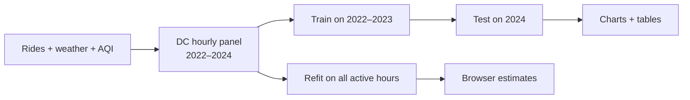

# PulseShift

PulseShift estimates the chance of low hourly demand across the DC-area Capital Bikeshare network. It is a research prototype: a 12-feature logistic regression model uses weather, air quality and time of day. The browser app accepts manual inputs or loads a DC forecast to compare daytime hours.

[Open the app](https://urmeo.github.io/pulse-shift/) · [Visual results](https://urmeo.github.io/pulse-shift/results/) · [Data, methods and limitations](results/README.md) · [Development](docs/development.md)

## Pipeline



Historical evaluation and the browser refit use separate models. Low demand means fewer than half the expected network rides. Training and evaluation include only hours with at least 20 expected rides.

## Results at a glance

| ROC curves | Precision–recall curves |
| --- | --- |
| [](results/figures/roc.png) | [](results/figures/precision_recall.png) |
| **Calibration** | **Model comparison** |
| [](results/figures/reliability.png) | [](results/figures/model_comparison.png) |

The unweighted logistic model was trained on **16,150 active hours in 2022–2023** and tested on **8,204 active hours in 2024**:

| AUROC ↑ | Average precision ↑ | Brier score ↓ | Calibration error ↓ |
| ---: | ---: | ---: | ---: |
| 0.936 | 0.488 | 0.021 | 0.044 |

Its mean prediction was **6.88%**, while the observed low-demand rate was **2.46%**. Probabilities overestimate the 2024 event rate. The [results guide](results/README.md) includes confidence intervals, all model scores, the separate Seoul refit and simulated time-shift scenarios.

## Run locally

From the repository root:

```bash
python3 -m http.server 8000
```

Open [localhost:8000](http://localhost:8000) for the app or [localhost:8000/results/](http://localhost:8000/results/) for the visual report. Manual estimates run locally. Forecast loading requires internet access for Open-Meteo weather and CAMS US AQI data.

The research uses **Python, NumPy, pandas, scikit-learn, SciPy and Matplotlib**. The app uses HTML, CSS and JavaScript, with no runtime packages. See the [development guide](docs/development.md) to install research dependencies, run checks and regenerate the results.

## Repository layout

```text
index.html    Browser app entry point
app/          Browser code, styles and fitted model
research/     Python analysis, scripts, tests and processed data
results/      Visual report, figures, tables and methods
docs/         Development and reproduction guide
tests/        Browser behavior and Python/JavaScript agreement tests
```

This study measures aggregate bike-share demand. It does not measure health outcomes, individual activity or observed benefits from shifting rides. Recovery figures are simulations; live forecast accuracy has not been measured. Forecast comparisons exclude heat index ≥103°F and AQI ≥150, using study thresholds. Follow official advisories. See the [full limitations and operating conditions](results/README.md#limitations-and-operating-conditions).

Author and sole contributor: [urmeo](https://github.com/urmeo). Code is covered by the [MIT license](LICENSE); data providers' terms apply separately.
